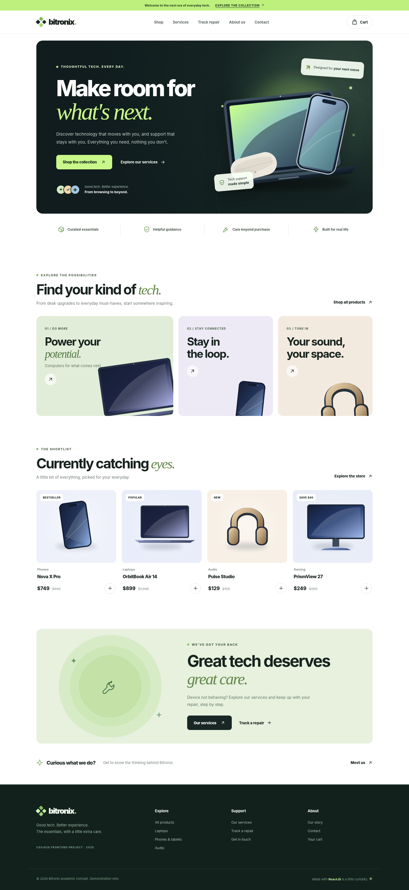
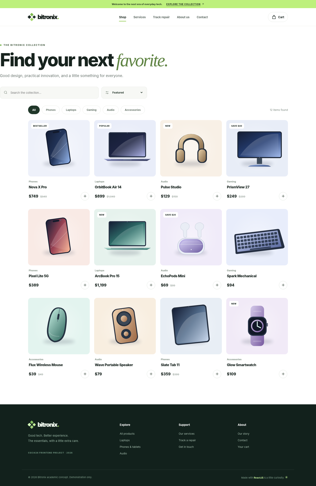
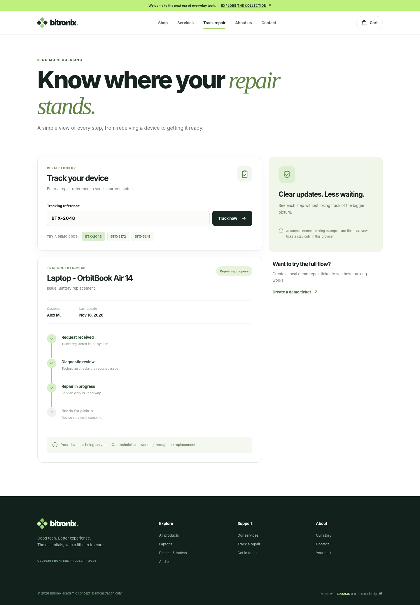
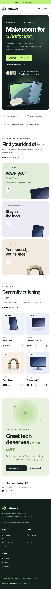

# BITRONIX — Technology Store & Repair Portal

**CSCI426 — Advanced Web Programming | Project Phase 1 | Fall 2026**

**Prepared by:** Mahdi Bitar  
**Student ID:** 42330062  
**Course:** CSCI426 — Advanced Web Programming  
**Institution:** Lebanese International University (LIU)

A custom, mobile-responsive **ReactJS frontend** that combines product discovery, a sample shopping cart, a device-service catalog, and customer-facing repair status tracking. The project demonstrates interactive UI and local persistence without requiring a backend server.

> **Academic-theme note:** The assignment allows a student-proposed theme **with instructor approval**. This store-and-repair theme is not one of the six named themes, so obtain approval before submitting. All products, prices, orders, repair cases and contact submissions here are fictional demo data.

## Pages and routes

| Page | Hash route | Features |
| --- | --- | --- |
| Home | `#/` | Hero, categories, featured products, services CTA |
| Shop | `#/shop` | Search, category filters, sorting, 12 mock products |
| Product details (dynamic) | `#/shop/nova-phone` | Route-based product view, specifications, quantity picker, add to cart |
| Services | `#/services` | Four service types, repair process, expandable FAQs |
| Repair tracker (dynamic) | `#/track` | Status lookup, sample codes, progress timeline, create a local ticket |
| About | `#/about` | Mission, approach, brand values |
| Contact | `#/contact` | Validated contact form, local confirmation |
| Cart | `#/cart` | Add/remove products, change quantities, subtotals, demonstration checkout |

There are **8 page types**, exceeding the required minimum of five. Desktop, tablet and phone layouts are supported with CSS media queries.

## Quick start (no npm installation required)

1. Download or extract the project folder.
2. Open a terminal in the folder containing `index.html`.
3. Start a local static server:

   ```bash
   python -m http.server 8000
   ```

   On Windows, if `python` is unavailable, try `py -m http.server 8000`.
4. Open **http://localhost:8000** in a browser.

The static website loads `index.html`, the locally bundled React and ReactDOM UMD builds, `assets/app.js`, styles, and original SVG graphics. **No backend, external CDN, login or database is needed.**

### Editing the React JSX source

Readable React JSX lives in `src/app.jsx`; `assets/app.js` is the compiled browser version. Install TypeScript if you want to rebuild it:

```bash
npm install
npm run build
```

The build uses the TypeScript JSX transpiler (`jsx: "react"`), which converts JSX to `React.createElement` calls. Refresh the browser afterward. React itself is bundled locally as the pre-existing MIT-licensed React 16.0 UMD distribution; the project uses class components to be compatible with that runtime.

> Changes to `src/app.jsx` will **not** appear until `npm run build` is run. Edit `assets/styles.css` directly for style changes.

## Demonstrate the key features

1. In **Shop**, search for `OrbitBook`, click the `Audio` filter, or sort by price.
2. Open a product, choose a quantity and add it to the demo cart. In **Cart**, change a quantity or place a **demo order** (no payment is made).
3. In **Track repair**, try `BTX-2048`, `BTX-3172`, or `BTX-5241` to see three different statuses. You can also create a browser-local demo ticket and use its generated code.
4. In **Contact**, enter a valid email address and a message, then press **Save demo message**. A success notice confirms only local storage.
5. Resize the window or open the site on a phone to inspect responsive behavior and mobile navigation.

Browser-local keys: `bitronix_demo_cart`, `bitronix_demo_tickets`, `bitronix_demo_messages`. Use your browser's site-data controls to reset these demos.

## System design

```text
Browser
  |
  +-- index.html
  |     +-- React + ReactDOM (local vendor bundles)
  |     +-- assets/app.js (compiled from src/app.jsx)
  |     +-- assets/styles.css (responsive design)
  |
  +-- Hash navigation (#/shop, #/track, etc.)
  |     +-- Components: Home, Shop, Product, Services, Track,
  |                     About, Contact, Cart
  |
  +-- Local state and browser localStorage
        +-- Cart items & quantities
        +-- Example/custom tracking tickets
        +-- Saved contact messages
```

**Why hash routing?** It works with ordinary static GitHub Pages hosting without special server rewrite rules. App state and route state are managed with React; there is no backend or external API.

## Screenshots

| Desktop: home | Desktop: shop |
| --- | --- |
|  |  |

| Repair tracker | Mobile home |
| --- | --- |
|  |  |

Additional screenshots: `screenshots/shop-mobile.png`, `screenshots/cart-desktop.png`, `screenshots/contact-desktop.png`.

## Version control and GitHub deployment

A local Git repository with multiple meaningful commits is included in the downloadable ZIP. You can inspect it with:

```bash
git log --oneline --graph --all
```

To submit a real GitHub link:

1. Make a new **public** repository on GitHub (for example `bitronix-csci426-phase1`).
2. From this extracted folder, run:

   ```bash
   git remote add origin https://github.com/YOUR_USERNAME/bitronix-csci426-phase1.git
   git branch -M main
   git push -u origin main
   ```

3. In the GitHub repository, go to **Settings → Pages**, choose **Deploy from a branch**, select `main` and **/(root)**, then save.
4. Copy your live URL and repository URL into your final classroom submission. GitHub may take a little time to publish; the repository's Pages settings displays the live address.
5. Open the live site and click through the pages and example repair codes to verify deployment.

**URLs to complete after upload:**
- GitHub repository: `https://github.com/YOUR_USERNAME/bitronix-csci426-phase1`
- GitHub Pages: `https://YOUR_USERNAME.github.io/bitronix-csci426-phase1/`

These are **placeholders, not live project links**.

### Alternative deployment

You can deploy the folder as a static site using Netlify or Vercel. The publish directory is the project root, and no build step is necessary because compiled assets are already committed.

## Assignment checklist

- [x] ReactJS frontend; JSX source included
- [x] Five or more page types; both standard and dynamic views
- [x] Responsive desktop/mobile layouts
- [x] Git repository and multiple commits
- [x] Ready for GitHub Pages / Netlify / Vercel
- [x] README with description, instructions, screenshots, student name and ID
- [x] PDF report with title, abstract, system design, technology and key snippets
- [ ] **Instructor approval for custom theme**
- [ ] **Your name / student ID on the report**
- [ ] **Upload repository to your GitHub account and enable live deployment**
- [ ] **Submit the PDF and real GitHub repository URL to Google Classroom**

## Tests and known limitations

- Browser smoke tests: `docs/smoke_test.py`, covering navigation, search/filter, cart, checkout, tracking, ticket creation, contact form, and mobile layout. Screenshots were captured using headless Chromium.
- This is **Phase 1 frontend only**. No actual sales, payment transactions, real customer repair records, live inventory, authenticated accounts or sent emails are implemented.
- All mock data is illustrative, not a claim about actual products or real Bitronix operations.
- The sample contact form and locally created repair tickets should not be used to enter sensitive personal information because they are only demonstration features.

## Project credits and originality

Website composition, design, SVG product illustrations, and demonstration data were made specifically for this project (with AI assistance). React and ReactDOM are third-party MIT-licensed libraries; see `THIRD_PARTY_NOTICES.md`. This is **not a downloaded or copied website template**. Follow your instructor's policy for acknowledging AI-assisted work and be prepared to explain the code and design decisions.
